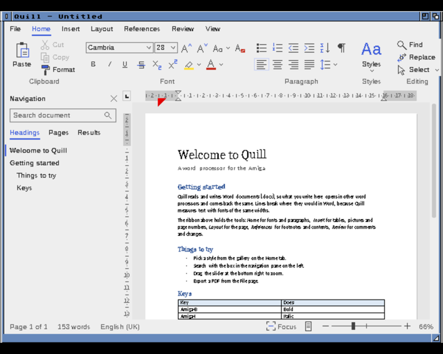
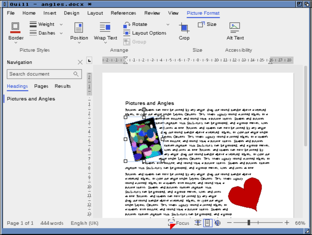
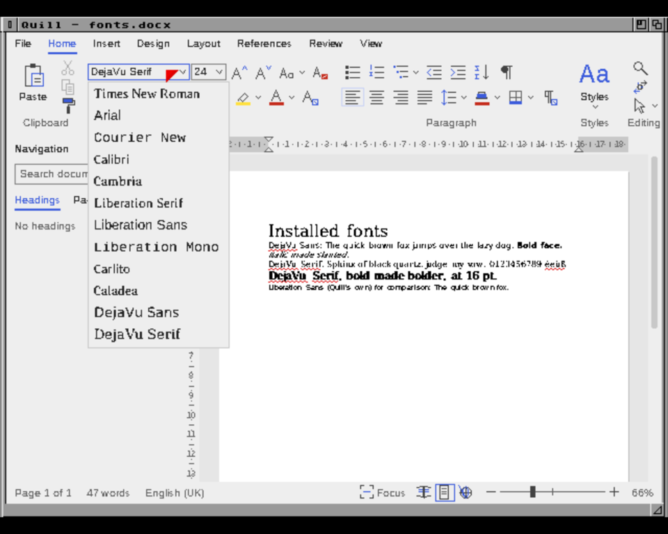
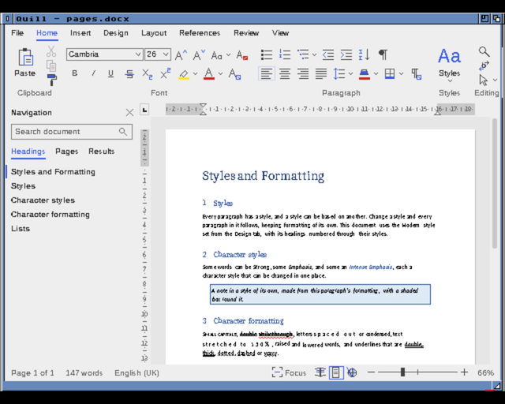
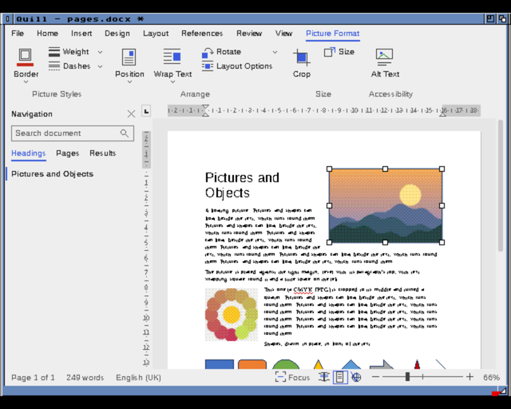
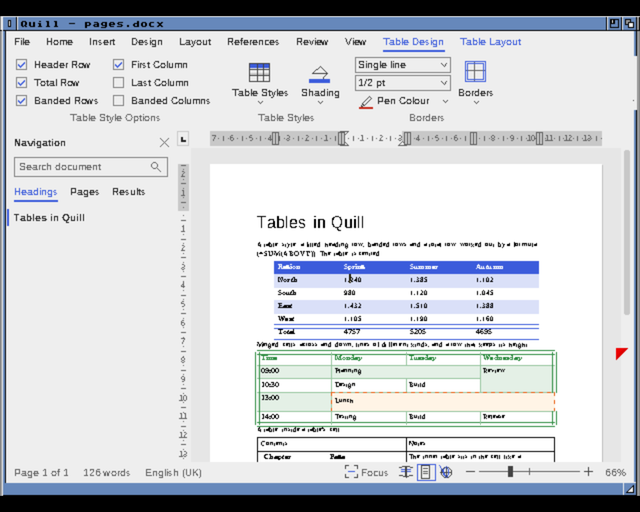
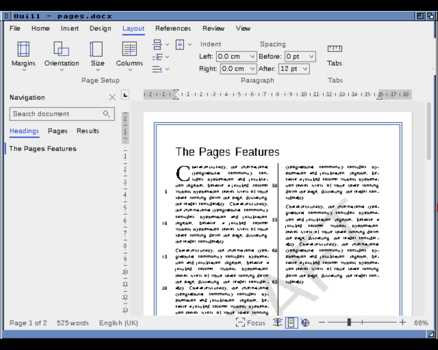
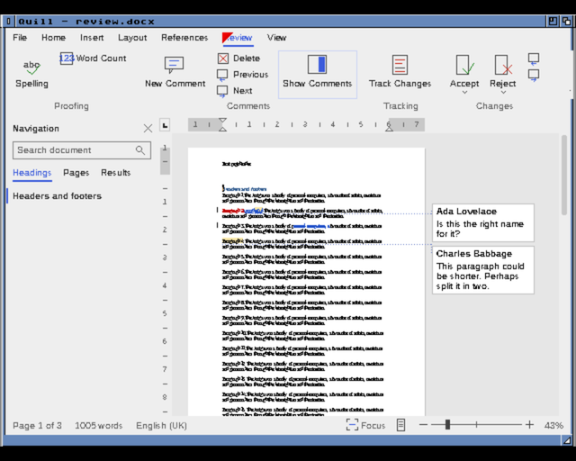
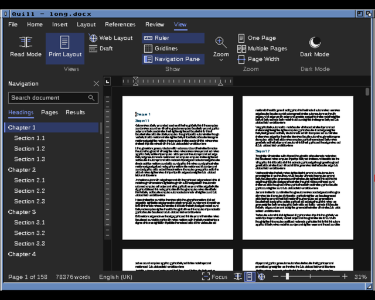
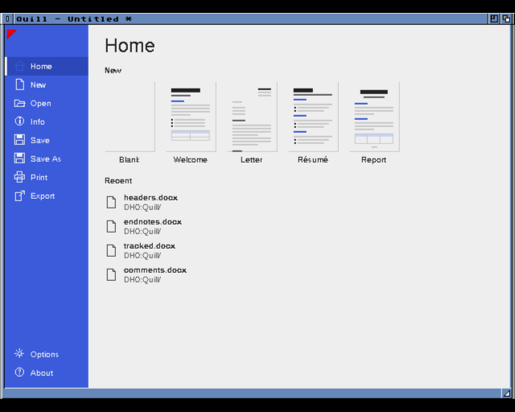

# Quill: a word processor for the Amiga

Quill 0.14 is a native word processor for AmigaOS with a MUI interface. It reads and writes Word documents (.docx) and lays them out the way Word does. It is written in C for a 68040 or better with plenty of RAM. Its design and look follow WordCraft, an open-source word processor in Rust (see "Why C, not a port").



## Character and paragraph formatting (work packages 9 and 10)

- **Text effects:** hidden text (shown, with a dotted line under it, only while formatting marks are on, and left out of PDFs), outline, shadow, emboss and engrave, a colour for the underline of its own, and character shading kept apart from the highlight. They are in the Font window, the Font group's Text Effects list, the Format menu and the right-button menu, and go to and from Word. Word 2010's other text effects (glow, reflection, gradient fills), ligatures and number forms are kept through a save.
- **Enclosed characters:** one or two characters in a circle, square, triangle or diamond, saved as Word saves them (an EQ field).
- **Paragraphs:** Distributed alignment (Ctrl-Shift-J), Add Space Before (Ctrl-0) and Remove Space After, a Horizontal Line, Hanging Indent (Ctrl-T, Ctrl-Shift-T), and lists to choose from on the Bullets and Numbering buttons, with Define New Bullet and Define New Number Format (01, 1st, One, First as well).
- **Sort Text:** by up to three keys, whole paragraphs or fields between tabs or commas, as text, numbers or dates, either way round.
- **Characters:** nonbreaking spaces (Ctrl-Shift-Space, a degree sign with formatting marks), nonbreaking hyphens (Ctrl-Shift-minus) and optional hyphens (Ctrl-minus, shown only where a line breaks); lines now break after an ordinary hyphen. The Symbol window has every character the screen can show, any character by its code, the recently used ones and a page of special characters.
- **Clipboard:** a Paste Special window, Copy and Paste Formatting (Ctrl-Shift-C, Ctrl-Shift-V), and the Clipboard pane beside the page with the last 24 things copied.

## New in 0.14: arranging, bookmarks, page numbers and the Design tab

These come from comparing Quill with WordCraft's Home, Insert, Draw, Design and Layout tabs.

- **Arranging floating objects** (pictures, shapes, text boxes and groups):
  - **Bring Forward** and **Send Backward** put the selected object in front of or behind the one next to it. Their arrows offer **Bring to Front** and **Send to Back**. Each is one undo step.
  - **Align:** with one object chosen, lines it up with the margins (left, centre, right, top, middle, bottom). With several chosen (Shift-click), lines them up with each other, or **Distribute Horizontally** and **Vertically** spaces them evenly.
  - **Selection Pane:** a window listing every floating object, page by page, the topmost first. Choose one to select it, or move it up and down the stack from there.
  - They're on the **Layout** tab (a new **Arrange** group, with Position, Wrap Text, Group and Rotate) and on the **Picture Format** and **Shape Format** tabs. The stacking order is read from and written to .docx files and kept in PDFs.
- **Bookmarks and cross-references:**
  - **Insert > Bookmark** names the selected text, or the caret's paragraph, so you can come back to it. The Bookmark window lists them, and adds, removes and goes to them.
  - **Insert > Cross-reference** types a reference to a bookmark or a heading: its text, or the number of the page it's on. The page number keeps itself up to date as the document changes. Ctrl-click a reference to go there.
  - Links to a place in the document (`#name`) now work: Ctrl-click one and Quill goes to that bookmark.
  - Bookmarks and REF/PAGEREF fields are read from and written to .docx files.
- **Page numbers and cover pages** (Insert tab):
  - **Page Number** puts the number at the top or foot of every page, left, centre or right, or "Page 1 of 3" at the foot. **Format Page Numbers...** chooses 1, 2, 3, a, b, c, A, B, C, i, ii, iii or I, II, III, and the first number. **Remove Page Numbers** takes them out again.
  - **Cover Page** puts a title page before the text in one of three designs (Simple, Banded and Side Line), with the document's title, a subtitle, your name and today's date to type over. Choosing again swaps the design. **Remove Current Cover Page** takes it out.
- **The Design tab, reworked:**
  - **Themes:** eight looks (Quill, Amiga, Workbench, Boing, Kickstart, Paper, Lagoon and Velvet). Each sets the style set, the fonts and the heading colours together, in one undo step. The list shows each one's title and heading in its own fonts and colours.
  - **Colors:** eight colour sets for the headings, title and subtitle.
  - **Style Set:** the list now shows each set's title and heading, as they'll look.
  - **Page Color:** a colour behind every page. It shows on the screen and is saved in .docx files and PDFs. **More Colours...** picks any colour.
  - **Set as Default:** new blank documents start with this document's style set, fonts, paragraph spacing and colours. The choice is kept in Quill.prefs.
- **Home tab:**
  - **Underline** is a split button. A click underlines. The arrow offers double, thick, dotted, dashed and wavy underlines, words only, and **More Underlines...** (the Font window). Each kind is drawn in the list.
  - **Character Border:** a thin box round the selected characters (also on the Format menu). It's saved in .docx files and drawn in PDFs.
  - The ribbon still fits a 640-pixel-wide screen. Icon buttons are two pixels narrower when space is tight, and the small buttons show their labels whenever the window has room.
- Enclosed characters (a letter in a circle) came later: see "Character and paragraph formatting" above.
- **Bugs fixed:** line numbering started from 1 even when a document asked for another first number.

## New in 0.13: links, right-click menus and the missing pieces

- **Hyperlinks.** Select some text and choose **Insert > Link** (the ribbon's Links group, or the Insert menu) to make it a link to a web page, an e-mail address or a place in the document (`#name`). "www.amiga.org" becomes "https://www.amiga.org" and an address with an @ in it becomes "mailto:". Links are blue and underlined, in Word's Hyperlink style. Rest the pointer on one and its address shows on the status bar. **Ctrl-click** opens it with openurl.library (and your web browser). Without openurl.library, Quill tells you where the link goes. Typing at the end of a link doesn't make it longer. Links are read from and written to .docx files, including the field form that LibreOffice and older Word versions write, and they are kept as clickable links when you export a PDF.
- **Right-click menus:**
  - **On a misspelled word:** the suggestions, then **Ignore All**, **Add to Dictionary** and **Spelling...**
  - **On a picture, shape or group:** Cut, Copy and Paste; **Edit Text**; **Format...**; **Wrap Text** and **Rotate** as submenus; **Size...**; **Crop...**; **Group** and **Ungroup**; **Alt Text...**
  - **On text:** Cut, Copy and Paste; **Font...** and **Paragraph...**; in a table, **Insert** and **Delete** submenus with Merge, Split and Table Properties; **New Comment**; **Select All**
  - **On a link:** **Open Link**, **Edit Link...**, **Copy Link Address** and **Remove Link**
- **Pieces that were missing, found by going through WordCraft's ribbon tab by tab:**
  - **Save** joins Undo and Redo at the right end of the tab strip.
  - **Split buttons.** Paste, Find, Header, Footer and Table of Contents each work at a click on the button. A click on the arrow opens a list:
    - **Paste:** keep the source formatting, merge it or paste the text only
    - **Find:** **Go To**, for a page by its number (also on the Edit menu)
    - **Header** and **Footer:** **Remove Header** and **Remove Footer**
    - **Table of Contents:** **Remove Table of Contents**
  - **Insert > Blank Page.**
  - **References > Add Text** puts the caret's paragraph in the table of contents at level 1, 2 or 3, or leaves it out.
  - **Select Sentence** and **Select Paragraph** in Home's Select list.
  - **Next List Level** and **Previous List Level** in the multilevel list menu.
  - **Inside Borders:** a line between paragraphs, in the paragraph Borders list.
  - **Drop Cap Options...**: where the letter goes and how many lines it covers, from 1 to 10.
  - **Line Numbering Options...**:
    - the first number
    - how far from the text
    - every how many lines
    - whether numbering restarts each page or each section, or runs on
  - **Colours:** six more colours in the font colour list. The font, pen, shading, fill and outline lists end with **More Colours...**, which opens MUI's colour wheel if Coloradjust.mui is installed, or red, green and blue sliders if it isn't.
  - **Paper and margins:** A3, A6, B5, Executive and Tabloid paper, plus a "roomy" margin preset (3.17 cm at the sides). **More Paper Sizes...** and **Custom Margins...** open Page Setup.
- **Bugs fixed:**
  - A drop cap on a paragraph shorter than the cap (a one-line title, say) was drawn too far down, over the next paragraph.
  - Counting by more than one line could make line numbers skip after a widow was moved to the next page.

## New in 0.12: several documents, help and speed

- **Several documents at once.** Each document has a window of its own, with its own ribbon, rulers, navigation pane and status bar. **New** (Amiga-N, or a template on the File page) always opens a new window. **Open** and the recent documents use a new window too, unless the window you're in holds an untouched blank document, which the file then takes over (as Word does). Opening a file that's already open brings its window to the front. **File > Close** (Amiga-W, or the window's close gadget) closes one window, asking first if there are unsaved changes. **Quit** goes through every window. **File > Next Window** (Amiga-`) cycles through them. Up to eight documents can be open at once. The Find, Font, Styles and other windows work on whichever document you're in.
- **Undo and Redo in the ribbon:** two buttons at the right end of the tab strip, always there whatever tab is showing. They grey out when there's nothing to undo or redo.
- **Help bubbles with more to say.** Rest the pointer on a ribbon tool and its bubble shows the name in bold, the keyboard shortcut if it has one, and a sentence or two on what it does. Tools that show only an icon are no longer a puzzle. The status bar (page, word count, Focus, view buttons, zoom), the navigation pane (close box, search, tabs) and the rulers have bubbles now too. On the rulers they say which marker is under the pointer (first-line, left or right indent, a tab stop, a table's column edge) and what dragging it does. All of them are in German, French, Spanish and Italian as well.
- **Spelling, checked over:**
  - **Better suggestions:** they are now ranked by how people actually mistype. A doubled or missing double letter ("speling", "Thiss") comes first, then two letters swapped ("tset"), a letter left out ("cheker"), a neighbouring key or the wrong vowel. Very common words get a small push. Before, the first word found came first, so "speling" offered "spewing" ahead of "spelling".
  - **Change to:** the Spelling window has a **Change to** field. It holds the chosen suggestion and can be edited, or you can type your own word when nothing in the list fits.
  - **Greyed buttons:** the buttons grey out when the check is complete.
- **Faster scrolling and caret movement, with the blitter.** Moving the caret no longer redraws the page at all: only the caret moves. When the view scrolls by less than most of a screen, the picture already drawn is moved with `ScrollRaster` (the blitter on the Amiga's own chips, the graphics card's blitter under Picasso96 or CyberGraphX), and only the newly exposed strip is drawn. In the test below, 90 cursor key presses through a long document cost 6 strip drawings and 4 full drawings (55 ticks in all) instead of 84 full drawings (909 ticks). Anything that depends on the caret's place, such as the word being typed not being underlined yet, is brought up to date with one full drawing once you pause.
- **A bug fixed in multilevel lists:** the Legal style's ninth level ("1.1.1.1.1.1.1.1.1.") overflowed its label and could corrupt memory.
- **A bug fixed in Modify Style:** after the window had been opened a few times, its Font field could no longer be made (so the window failed to open), and picking a font could touch a field that was already gone.
- **Comments for developers.** Every function in the source has a comment saying what it is for, what it returns and what to watch out for: units, memory ownership, undo, and the MUI and Intuition background a newcomer needs.

## New in 0.11: pictures and angles

- **Turning by any angle:** select a picture, shape or text box and drag the **round handle** above it to turn it. An outline follows the pointer; hold **Shift** to turn in steps of 15 degrees. **Rotate > More Rotation Options** takes an exact angle in degrees (the Size tab of the Format window). Objects turn round their centre, and text wraps round where they are once turned. Sizing a turned object stretches it along its own sides.
- **Turned pictures** are drawn turned on the screen, with their border, and go into PDFs turned. Text in shapes and text boxes stays upright for now, on the screen and in PDFs (Word turns it with the shape).
- **More shapes,** 24 in all. New: pentagon, hexagon, octagon, parallelogram, trapezoid, right triangle, left, up and down arrows, plus, heart, speech bubble, chevron, pentagon arrow and four-point star. They are read from and written to Word files as Word's own preset shapes.
- **Groups:** click one floating object, then **Shift-click** others (each gets a dotted frame), and choose **Group** on the Picture Format or Shape Format tab. The group moves, sizes, turns, wraps and is copied as one object. **Ungroup** takes it apart, each object where it was and wrapping as it did. Groups from Word files (wpg:wgp), groups inside groups, and pictures in groups are read, shown, exported to PDF and saved.
- **Tight wrapping round the outline:** with **Tight**, text runs round a shape's own outline (a heart, a star, a turned rectangle) instead of its box. For a picture, Quill finds the outline itself by looking for where the picture differs from its corners' background colour, so text runs round a cut-out figure. Word's wrap polygons (wp:wrapPolygon) are read and written, so the outline is kept between Quill and Word.
- **The view keeps still** when an object is selected: it shows the object, not the place in the text it is anchored to.
- **Not yet:** editing the text of a shape inside a group (ungroup it first), drawing canvases, Word's rarer preset shapes (they still come in as rectangles), and turned text on the screen.



## New in 0.10: page furniture

- **Headers, footers, notes, comments and text boxes are edited in place** with full formatting: fonts, styles, colours, paragraph settings, tab stops, lists, pictures and fields. Everything that works on the main text works here too: the ribbon, menus, Font and Paragraph windows, find, spelling, and undo. The story takes the main text's place on the page, at its own width, with a tab saying what it is. **Close** (or Esc) goes back to the text where you left it; **Discard Changes** leaves the story as it was.
- **To edit a header or footer,** double-click it on the page, use **Insert > Header / Footer**, or press **Amiga-H**. To edit a footnote, double-click it at the bottom of the page. To edit a comment, double-click its balloon. To edit a text box's text, double-click the box or use **Edit Text**. **Insert Footnote** puts in a new note and opens it for editing.
- **The Header & Footer tab** (while one is edited) has:
  - the header and footer of the page, and the previous or next section's
  - page number and number-of-pages fields, the date and pictures
  - **Different First Page** (for each section) and **Different Odd & Even Pages**
  - **This Section's Own**, to give a section its own headers and footers instead of the document's
  - **Page Setup** for the distances from the edge
- **Page fields** are shaded grey while edited, and can go in the text too (they show the page they are on).
- **Sections with their own page setup:** each section can have its own paper size, orientation, margins, and header and footer distances. A landscape page can sit among portrait ones. Pages of different sizes are shown, exported to PDF and saved each at their own size.
- **Layout > Page Setup** sets the size and margins exactly, for the whole document or for the caret's section. With more than one section, the Margins, Orientation and Size choices change only the caret's section.
- **Sections' own headers and footers, and first pages, are read and written as Word keeps them,** including Word's "link to previous". A section without a reference has the one before's, and a first-page header or footer can be on each section's first page.
- **Pictures in notes and comments** are saved too.

## New in 0.9: font hinting

- **Sharper small text** in the fonts Quill draws itself (installed fonts without a font engine, and the font list's previews). Quill hints them its own way, from the outlines, so it works for TrueType and OpenType alike. Each font's alignment zones (baseline, x-height, capitals, ascenders, descenders) are measured from its letters and moved onto whole pixel rows, flattening overshoots at small sizes. Straight stems are moved onto whole pixels with an even width, and the rest of each letter follows between them. Stems come out even, letters sit on one baseline and reach one x-height, and crossbars land on a single row.
- **Dropout control:** a stroke thinner than a pixel, which would fall between two pixels and vanish, keeps its strongest pixel.
- Fonts Quill makes itself are built faster: a font of usual size is read at once rather than glyph by glyph, and the arithmetic stays in 32 bits.
- **Variable OpenType fonts (CFF2)** are drawn at their default design. Variable TrueType fonts already were. PDFs name CFF2 fonts rather than embed them, as PDF readers don't take them.
- `hinting=off` in `Quill.prefs` turns hinting off.

## New in 0.8: fonts, part two

- **OpenType fonts (.otf):** fonts with CFF outlines, the kind most OpenType fonts are, now work like TrueType ones. Quill reads their outlines itself (Type 2 charstrings, with their subroutines, and CID-keyed fonts too), lays documents out with them and embeds them in PDFs (as OpenType, PDF 1.6).
- **Font collections (.ttc):** every face in a collection is found and can be used. A PDF gets the face it uses, taken out of the collection, rather than the whole file.
- Installed fonts are found in `FONTS:_otf` and `FONTS:_ttc` too, and through `.otag` files naming a face of a collection. `Quill.fontcache` is rebuilt once for the new format.
- **Bold and italic in PDFs** for a family without such faces: the regular face, stroked to make it bold and slanted to make it italic, as the screen shows it.
- **Font licences:** a font whose licence doesn't allow embedding ("restricted", or bitmaps only) is no longer put into PDFs; the PDF names it, and a reader uses its own font instead.
- **Dark dialogs:** in the dark theme, the dialogs are dark too, with Quill's own labels, headings and buttons. (MUI's string, cycle and checkbox gadgets keep the colours set in MUI's preferences.)

## New in 0.7: fonts and interface



- **Every installed TrueType font:** Quill finds the fonts installed in FONTS: (those with a `.otag`, as FTManager, ttf.library's tools and AATextManager install them, and the files in `FONTS:_ttf`). Documents using them are laid out with their own widths, drawn on screen in them, and exported to PDF with them. What each file is gets remembered in `Quill.fontcache`, so only new or changed fonts are opened at the next start.
- **On screen, two ways:** a font installed with a `.font` file is drawn through diskfont.library and the system's font engine (hinted, and smoothed by AAText). Otherwise Quill draws it itself, from the font's outlines, with a TrueType renderer of its own. A family without a bold or italic face gets one made from the regular face.
- **A font list with previews:** the ribbon's font list shows every family in its own face. It lays out in columns when there are more fonts than fit down the screen. The Font and Modify Style windows have a field with the same list, where you can also type any family name.
- **Dialogs in Quill's style:** Find, Paragraph, Font, Tabs, Spelling and the other windows use Quill's interface font and the ribbon's colours, with flat buttons and plain section headings instead of MUI's engraved frames. (In the dark theme they keep MUI's colours, so MUI's own gadgets stay readable.)

## New in 0.6.1

- **Fonts on real AmigaOS, fixed properly:** Quill now reads its screen fonts' files itself and puts them in chip memory, with neither LoadSeg() nor diskfont.library involved. Both had failed on some real Kickstarts (an A1200 under FS-UAE among them), so Quill fell back to the system font. If its fonts still can't be opened, the warning now says which file and why.
- **Started from any shell:** some shells start programs without a program drawer (`PROGDIR:`), so Quill found neither its `Fonts` nor its `TrueType` drawer ("no fonts in PROGDIR:TrueType"). Quill now finds its drawer from the name it was started by.
- **No crash after File:** closing the window after visiting the File page could stop the machine with "Software Failure 8100 0005" (memory freed twice) under real MUI. MUI may set up and clean up objects again when they are hidden or shown. Quill now counts each of its objects once, and the File page is a page of its own, so the window no longer shrinks when File is opened either.
- **Window and screen** (File > Options > Window and screen): the public screen Quill opens on (`PUBSCREEN=name` also works from the Shell or as an icon tooltype), and where its window opens: nearly filling the screen, where it was last closed, or at a place and size you set.
- **AAText:** with [AAText](https://aminet.net/package/util/wb/AAText) running, Quill hands it its fonts: each Quill font gets a small `.otag` file in `T:QuillAAText` (or `RAM:QuillAAText`) that names the TrueType file it was made from. AAText then draws Quill's interface and pages antialiased on RTG screens. Put `aatext=off` in `Quill.prefs` to keep Quill's own bitmap fonts, or blacklist Quill in AATextPrefs.
- **A startup window** shows what Quill is doing as it starts, with a progress bar (and `DEBUG=file` logs each step's time).
- **Starts about ten times faster:** sorting the spelling list took most of the start-up time (51 of 53 seconds in emulation, more on a real 68040). The list now ships in Quill's order, and Quill only sorts lists that aren't in order already, with a sort that doesn't slow down on lists that are almost in order.

## New in 0.6: styles and formatting

- **Styles that inherit:** each style is based on another and sets only what it changes. Change a style and every paragraph in it follows, and so do the styles based on it, while formatting of a paragraph's own is kept. One undo step brings the style and its text back.
- **Managing styles:** **Design > Styles > Manage** lists every paragraph and character style, to apply, modify, delete (its text takes the style it was based on), make a new paragraph or character style from the formatting at the caret, or **Update to Match Selection**.
- **Modify Style:** a style's name, what it is based on, the style that follows it, font, size, colour, bold, italic and underline, alignment, spacing, line spacing, indents, keep with next, and whether it shows in the gallery.
- **Character styles:** Strong, Emphasis, Subtle Emphasis, Intense Emphasis and Hyperlink to begin with, from the gallery; text in one changes when the style does. Word documents' character styles are read and written with their text.
- **The Font window:** font, style, size, colour, seven kinds of underline (single, double, thick, dotted, dashed, wavy, words only), strikethrough and double strikethrough, superscript and subscript, small capitals and all capitals, and character spacing: expanded or condensed, scaled from 33% to 200%, raised or lowered.
- **The Paragraph window:** alignment, indents with a first-line or hanging indent, spacing before and after, line spacing (single, 1.5, double, at least, exactly, multiple), no space between paragraphs of the same style, widow and orphan control, keep with next, keep lines together, and a page break before.
- **Borders and shading for paragraphs:** a line above, below, left, right or between paragraphs, in any kind, width and colour, and a fill behind them (**Home > Borders**, **Shading**, or **Borders and Shading**). Paragraphs with the same borders share one box.
- **Multilevel lists:** 1. a. i., 1) a) i), I. A. 1. a), 1. 1.1. 1.1.1. and bullets ready made; **Define New List** sets each level's numbering, start and indents; **Restart at 1**, **Continue Numbering** and **Set Numbering Value**.
- **Heading numbering:** 1, 1.1, 1.1.1 on the headings through their styles, so new headings are numbered as they are made.
- **Document formatting:** **Design > Style Set** (Quill, Modern, Classic, Elegant, Simple, Bold), **Fonts** for the text and headings, and **Paragraph Spacing** (none, compact, tight, open, relaxed, double) for the whole document at once.
- **Copy and paste with formatting:** text copied in Quill is pasted with its formatting, styles, lists and pictures, into the same document or another; **Edit > Paste Special** keeps the source formatting, merges it with the text around (keeping bold, italic and underline), or pastes the text only. Other programs still get the text through the clipboard.
- **Word files:** styles with w:basedOn and only their own settings, document defaults, character styles and w:rStyle, w:pBdr, w:shd, w:keepLines, w:widowControl, w:contextualSpacing, w:smallCaps, w:dstrike, the kinds of w:u, w:spacing, w:w and w:position, read and written. LibreOffice opens Quill's styles and formatting as Quill draws them.
- **Not yet:** borders round headers' and footers' paragraphs, linked styles shown as one, a style's tab stops and borders in the Modify Style window (they are kept), and selecting all text with the same formatting.



## New in 0.5: pictures and objects

- **Floating pictures:** a picture can float on the page with the text running round it: **Square**, **Tight**, **Top and Bottom**, **Behind Text** or **In Front of Text**, or back **In Line with Text** (**Picture Format > Wrap Text**). Lines beside it stop short of it, at the distance from the text it asks for, and carry on past it on the other side; lines above its anchor on the same page wrap round it too.
- **Position:** nine places on the page from **Position** (top left to bottom right of the margins), or exactly, in **Layout Options**: left, centred, right or an offset, from the column, the page or the margin across, and from the paragraph, the page or the margin down.
- **Drag to move, drag to size:** click a picture, shape or text box to select it (eight handles appear), drag it to move it, or drag a handle to size it. A picture's corners keep its shape. Each drag is one undo step.
- **Turning and flipping:** **Rotate** turns a quarter right or left, or flips it vertically or horizontally.
- **Cropping:** **Crop** cuts a share off each side of a picture.
- **Borders:** a line round a picture in any colour, weight (1/4 to 3 points) and kind (single, double, thick, dotted, dashed).
- **Alt text:** a description of a picture or shape, kept in Word files, for people who can't see it.
- **Shapes:** **Insert > Shapes**: rectangle, rounded rectangle, oval, line, arrow, triangle, diamond, right arrow and star, with **Shape Fill** and **Shape Outline** colours, outline weight and dashes. They float like pictures.
- **Text boxes:** **Insert > Text Box** puts a box of text the page's text runs round. Double-click it (or **Edit Text**) to write its text, a paragraph to a line. Shapes from Word files keep any text in them.
- **More JPEGs:** progressive JPEGs and CMYK (and YCCK) JPEGs from Photoshop are decoded now, with restart markers and any sampling.
- **New ribbon tabs:** Picture Format and Shape Format appear while a picture or shape is selected, as in Word; the Insert menu has Shape and Text Box, the Format menu Picture or Shape.
- **Word files:** floating pictures and shapes (wp:anchor, wps:wsp) with their position, wrapping, distance from the text, crop (a:srcRect), turning and flipping, outline, fill (theme colours with their tints and shades too), alt text and text box text, read and written; pictures and shapes in headers float there too. LibreOffice opens Quill's pictures, shapes and text boxes where Quill puts them.
- **PDF:** floating pictures, shapes and text boxes as on the screen, cropped and turned; JPEGs still go in as they are.
- **Not yet:** turning by any angle (only quarter turns), Word's other preset shapes (they come in as rectangles), grouped shapes and drawing canvases, wrapping round a picture's outline (Tight wraps round its box), editing a text box's text in place, cropping by dragging, and the order objects overlap in (the selected one is drawn on top).



## New in 0.4: tables

- **Table styles:** a look for the whole table (lines, fills, the heading row's text) from **Table Design > Table Styles**, each shown as a little picture of itself: Table Grid, Quill Lines, Quill List, and Banded and Grid styles in seven colours. Word's own table styles in a document (Grid Table 4, Light List, Medium Shading...) are read as Word draws them, with their heading row, total row, first and last columns, banded rows and columns, and corner cells.
- **Table Style Options:** Header Row, Total Row, Banded Rows, First Column, Last Column and Banded Columns turn the style's parts on and off.
- **Borders:** a pen (single, double, thick, dotted or dashed line; 1/4 to 3 points; a colour), then All, Outside, Inside, Inside Horizontal, Inside Vertical, Top, Bottom, Left or Right borders, or none, on the selected cells (**Table Design > Borders**). Each cell edge keeps its own kind of line, width and colour, in Word files too.
- **Merging any block of cells:** across, down, or both at once (**Table Layout > Merge Cells**); the cells' text goes into the merged one.
- **Splitting cells** into any number of columns and rows, a merged cell back into the cells it covered (**Split Cells**), and **splitting a table** in two at the caret's row (**Split Table**).
- **Tables inside tables:** **Insert > Table** in a cell puts a table in the cell, one level deep. Word documents with them are read and written as they are (deeper ones are flattened into the inner table's cells).
- **Selecting cells:** a selection over several cells is a block of whole cells, shown as cells; formatting, deleting and copying take just those cells, so a column can be made bold on its own. **Table Layout > Select** selects the cell, its column, its row or the table.
- **Column widths by dragging:** drag a column's edge on the page, or its marker on the ruler. **Height** and **Width** set the row's height and the column's width; **Distribute Rows** and **Distribute Columns** even them out.
- **AutoFit:** columns as wide as their text, the table as wide as the page, or fixed widths.
- **Table Properties:** the table's alignment (left, centred, right) and indent, cell margins on all four sides, the row's height (automatic, at least or exactly), whether a row may break across pages, and heading rows.
- **Rows across pages:** a row that doesn't fit now runs on to the next page, as in Word, unless it is set not to break; the heading rows repeat above the part that runs on.
- **Sort:** the rows by any column, as text or as numbers (commas, decimals and minus signs understood), up or down, the heading rows staying put.
- **Formula:** Word's =SUM(ABOVE), =AVERAGE(LEFT), =MAX(B2:B5), COUNT, MIN, PRODUCT, ABS and INT, cell names and + - * /, worked out for the caret's cell and put in as its result.
- **Converting:** a table to text, its cells separated by tabs, commas or semicolons; and text back to a table (**Insert > Text to Table**), split at tabs, commas, semicolons or by paragraph.
- **View Gridlines:** dotted lines where cells have no borders.
- **New ribbon tabs:** Table Design and Table Layout appear while the caret is in a table, as in Word; the Table menu has the new commands too.
- **Word files:** table styles with their conditional formatting (w:tblStylePr), w:tblLook, cell borders with their kind, width and colour, w:jc, top and bottom cell margins, w:cantSplit, w:tblLayout and nested tables, read and written. LibreOffice opens Quill's tables with their styles, merged cells, lines and nested tables as Quill draws them.
- **Not yet:** text direction in cells (vertical text), tables with text wrapping round them (floating tables are placed in the text), and drawing tables with the mouse.



## New in 0.3.2

- **Fonts on real AmigaOS, again:** Quill now loads its screen fonts itself, straight from the size files in its `Fonts` drawer, rather than asking diskfont.library for them. On some real Kickstart/diskfont setups (an A1200 under FS-UAE among them) diskfont.library still wouldn't open them from the program's drawer, so Quill showed its warning and fell back to the system font. diskfont.library is now only used to scale a font beyond the biggest size Quill ships, and as a last resort.

## New in 0.3.1

- **Fonts on real AmigaOS:** Quill now opens its screen fonts straight from its own `Fonts` drawer (`PROGDIR:Fonts/...`) instead of relying on that drawer joining `FONTS:`, and the font files ask for chip memory, which the blitter needs to draw them on AGA and ECS screens. Before, on some systems the fonts didn't open: text came out tiny in the system font, its letters spread apart at the places the layout gave them.
- **A warning** if the fonts still can't be opened, saying where they should be.
- **Text size:** **File > Options > Text size** makes the interface's text large (15 pixels instead of 11).
- **The File page** in a short window: the Options and About entries no longer overlap the others.

## New in 0.3: pages

- **Columns:** a section's text in one, two or three columns (up to six read from files), with a line between them if you like (**Layout > Columns**). The ruler follows the column the caret is in.
- **Section breaks:** next page, continuous, even page and odd page (**Layout > Breaks**). Each section has its own columns; a continuous one starts below the last on the same page. With formatting marks on, a dotted line says where a section ends and how the next begins.
- **Column breaks:** **Layout > Breaks > Column break** sends the text on to the next column.
- **Line numbers:** beside the lines, continuous or starting again on each page or section (**Layout > Line Numbers**). Files can number every nth line.
- **Vertical alignment:** the text at the top, middle or bottom of the page (**Layout > Vertical Align**), for title pages.
- **Automatic hyphenation:** long words broken with a hyphen at the ends of lines (**Layout > Hyphenation**), with British English patterns (Liang's method, TeX's patterns as LibreOffice ships them), only where the gap left would be at least a quarter of an inch, as Word does.
- **Drop caps:** the paragraph's first letter large over three lines, in the text or in the margin (**Insert > Drop Cap**).
- **A new Design tab:**
  - **Watermark:** DRAFT, CONFIDENTIAL, SAMPLE, DO NOT COPY, URGENT or your own words, diagonal or across, light behind the text on every page.
  - **Page Borders:** a single, double, thick, dotted or dashed line round every page.
- **Headers and footers for even pages:** **Insert > Header** has "Different odd and even pages" and the even pages' own header and footer.
- **Bubble help:** resting the pointer on a ribbon tool says what it does (handy when a narrow window shows only its icon).
- **Word files:** all of these are read and written as Word does it (w:sectPr in paragraphs and the body, w:cols, w:lnNumType, w:vAlign, w:pgBorders, column breaks, framed drop caps, the watermark's VML shape in the header, w:autoHyphenation). LibreOffice opens Quill's files with the columns, line numbers, drop cap, watermark and border in place.
- **Not yet:** sections share one page size, orientation and set of margins, and one set of headers and footers; columns are of equal width and aren't balanced before a continuous break; a page border is the same on all four sides; watermarks are words only (not pictures).



## New in 0.2

- **Views:** Read Mode, Print Layout, Web Layout and Draft, from the View tab, the View menu or the buttons on the status bar.
- **Several pages side by side:** **View > Multiple Pages** shows two pages a row; Read Mode does too.
- **Gridlines** over the page, to line things up.
- **Dark Mode:** a dark page with light text on screen. The document itself doesn't change, and printing and PDFs stay black on white.
- **A dark interface:** **File > Options > Theme** sets the ribbon, panes and File page light or dark.
- **Other languages:** the interface in English, German, French, Spanish or Italian (**File > Options > Language**). Quill starts in the language Locale prefers, if it has it. The ribbon, panes and windows change at once; the menus change the next time Quill starts.
- **Long documents in less memory:** laying a document out again (in Web Layout, say) no longer needs room for two copies of its layout, and if memory runs out the layout stays usable as far as it got.
- **Fixes:** Esc no longer closes the window under Zune, and the File page's Home and back icons show again.

| Part | What it is |
|---|---|
| `Quill` | The program: 730 KB, for AmigaOS 3.x with MUI 3.8 or later (MUI 5, or AROS's Zune). |
| `Fonts/` | Screen fonts: Amiga bitmap fonts made from the same TrueType fonts the layout measures with. Quill loads them from this drawer itself, so nothing needs installing. |
| `TrueType/` | The TrueType fonts the layout measures text with, `fonts.list`, and their licence. |
| `Dict/` | The word list spelling is checked against (British English, from SCOWL), the hyphenation patterns (British English, BSD-style licence), and their licences. |
| `Example.docx` | A sample document. |
| `Styles.docx` | A sample of 0.6's styles and formatting: the Modern style set, headings numbered through their styles, character styles, a boxed and shaded style of its own, character effects and a multilevel list. |
| `Objects.docx` | A sample of 0.5's pictures and objects: a floating photograph with the text round it, a cropped and turned CMYK picture, a row of shapes, a text box and a star behind the text. |
| `Tables.docx` | A sample of 0.4's tables: a table style with a formula's total, cells merged across and down, lines of several kinds, a table inside a table. |
| `Pictures.docx` | A sample with pictures: a PNG, a JPEG in a line of text, a logo in the header. |
| `Review.docx` | A sample with comments from two people and tracked changes, to accept or reject. |
| `Pages.docx` | A sample of 0.3's page features: two columns with a line between, line numbers, a drop cap, hyphenation, a watermark and a page border. |
| `Source/` | The source: `core/` (the portable core in C99, tested natively), `amiga/` (the MUI front end), `tests/` (382 native tests, with AddressSanitizer and UBSan, and sample documents), `tools/` and `build.sh`. |

## What it does

### Word documents

- **Formatting it reads and writes:**
  - **Characters:** bold, italic, underline of seven kinds, strikethrough and double strikethrough, capitals and small capitals, superscript and subscript, raised and lowered text, character spacing and scale, size, font, colour and highlighting.
  - **Styles:** paragraph and character styles based on one another, document defaults, and theme fonts.
  - **Paragraphs:** alignment, indents, spacing and line spacing, contextual spacing, borders and shading, tab stops (left, centred, right and decimal, with leaders), keep with next, keep lines together, widow control, and page breaks.
  - **The rest:** bulleted and numbered lists, page size and margins, and title and author.
- **Tables:** column widths, merged cells (across and down), borders with their kind, width and colour, cell shading, vertical alignment, row heights, rows that mustn't break, heading rows that repeat on each page, alignment and indent, cell margins, table styles with their conditional formatting, and tables inside tables (one level; deeper ones go into the inner table's cells).
- **Pictures:** PNG, JPEG, GIF, BMP and IFF ILBM pictures, in the text or floating with the text wrapping round them, cropped, turned, flipped and outlined, with alt text. Quill decodes them itself, at the size they are shown, and dithers them to the screen's colours: every kind of PNG, baseline, progressive and CMYK JPEG, and ILBM with EHB, HAM6/HAM8 and 24-bit. Their adjustments (brightness and contrast, sharpen and soften, greyscale, sepia, washout, black and white, recolouring, saturation, tone, transparency, artistic effects, a removed background) and picture styles (frames, shadows, rounded and snipped corners, ovals, soft edges) are read and written: those Word draws itself as `a:lum`, `a:grayscl`, `a:duotone`, `a:alphaModFix`, `a:clrChange`, the others drawn into the picture saved, the original kept for changing them again, as Word does.
- **Shapes and text boxes:** Word's preset shapes (basic shapes, block arrows, flowchart, callouts, stars and explosions: 93 of them) with their fill (a colour, a gradient or a picture), outline, shadow, glow and soft edges; text boxes with their text, its direction (turned 90 or 270 degrees), its place (top, middle, bottom) and margins, and linked text boxes whose text flows from one to the next; and icons.
- **Headers and footers:** including a different first page and even pages, page numbers ("Page 2 of 3"), pictures (logos) and text watermarks.
- **Pages and sections:** section breaks of each kind, columns (of their own widths, with a line between; balanced before a continuous break as Word does), column breaks, line numbers and page borders for each section, page borders in each of Word's line kinds with each side its own (its art borders drawn as a pattern), the gutter, mirror margins, two pages per sheet and book folds, vertical alignment (Justified too), drop caps, picture and text watermarks (washed out, solid or half transparent), and hyphenation with its zone, capitals and consecutive-hyphens settings.
- **Notes:** footnotes at the bottom of the page that refers to them, and endnotes (i, ii, iii) after the text, each under a short line.
- **Comments:** in balloons beside the page, joined to the text they are about.
- **Tracked changes:** insertions and deletions, with who made them and when.
- **A table of contents:** saved as Word's TOC field, so Word can update it too.
- **Text it keeps:** hyperlinks, content controls and field results keep their text. Field codes are left out (but page numbers and the table of contents are understood).
- **Not read yet:** VML pictures (from very old Word versions). Quill says when a document had any.
- **What it writes:** complete .docx files with the document's styles. LibreOffice and python-docx open them; Word itself hasn't been tried yet.

### Other files

- **PDF:** **Export** writes the pages as laid out. Each font goes in as a subset (only the letters used, so a PDF is kilobytes rather than the whole font files: a one-page letter about 30 KB instead of 370 KB), and any character the font has prints, Greek, Cyrillic and symbols as well as Western European text; copying and searching in a PDF reader find the words. Links to places in the document jump there (bookmarks, cross-references, table of contents entries, footnotes and endnotes and back), web links open, the headings make the reader's bookmarks panel, and the title, author, subject and keywords are in the document properties. **Export Options** (File page or File menu) chooses the pages, whether headings make bookmarks, and the subject and keywords.
- **Pictures of the pages:** **Export Image** (File page or File menu) saves each page as a PNG or IFF ILBM picture (24 bit), at 72 to 300 dpi, drawn by Quill itself exactly as the PDF shows it.
- **Plain text:** opened as UTF-8 or Latin-1 (Amiga text). **Save As Text** writes Latin-1.
- **RTF (.rtf):** opened and saved (**Save As**, or **File > Save As Rich Text...** for a copy) with styles, character and paragraph formatting, lists, tables with merged cells, pictures (PNG and JPEG; older metafile pictures show as an empty box of their size), headers and footers, footnotes and endnotes, links, bookmarks, page-number fields, sections and page setup, and tracked changes. Text in the single-byte Windows, DOS and Mac code pages and in Unicode. Shapes, text boxes and comments are left out when saving.
- **Web pages (.html, .htm):** opened and saved (**File > Save As Web Page...** for a copy) with headings, styles as CSS, paragraph and character formatting, lists, tables with merged cells, links, bookmarks and footnotes. Pictures are saved inside the page (data: URIs) and read from there or from files next to the page; nothing is fetched from the web. Headers, footers and page setup have no place in a web page.
- **Markdown (.md):** opened and saved (**File > Save As Markdown...** for a copy): CommonMark with GitHub's tables, strikethrough and footnotes. Headings, bold, italic, code, links, pictures, lists, block quotes and code blocks (in a Code style) come and go; fonts, colours and layout don't exist in Markdown.

### Layout like Word's

- **Fonts:** text is measured with the metrics of TrueType fonts, not the screen's. Liberation Serif, Sans and Mono have the same character widths as Times New Roman, Arial and Courier New; Carlito matches Calibri and Caladea matches Cambria. So a document breaks its lines where Word breaks them.
- **Line heights:** single spacing uses Windows' font metrics, as Word does.
- **Pagination:** with widow and orphan control and keep with next. A table row that doesn't fit runs on to the next page below the repeated heading rows (one that mustn't break moves there whole). A tall header or footer pushes the text in.
- **Also:** justification, tab stops and leaders, and list labels with their counters (1., a., i., %1.%2.).

### Editing

- **Typing:** typing, selecting with the mouse or keys, and cut, copy and paste through the clipboard.
- **Undo:** undo and redo, with typing undone a word at a time.
- **Formatting:** from the ribbon, menus and keys: fonts, sizes (grow and shrink a step at a time), colours, highlighting, underline kinds, small capitals, character spacing, raised and lowered text, change case (sentence, lower, UPPER, Capitalise Each Word, tOGGLE), clear formatting, the format painter, and paragraph and character styles from the styles gallery.
- **Styles:** make, modify, delete and update styles; whole-document style sets, fonts and paragraph spacing.
- **Paragraphs:** alignment, indents and spacing, line spacing, borders and shading, keeping lines together, tab stops (on the ruler or in **Layout > Tabs**), sorting paragraphs A to Z, and formatting marks.
- **Lists:** bullets, numbering and multilevel lists, defined level by level, restarted or continued; Tab and Shift-Tab change the level, and Return in an empty item ends the list.
- **Tables:** insert a table (in a cell: a table inside it), then insert and delete rows and columns, merge any block of cells and split cells into columns and rows, split the table, apply a table style and its options, borders and shading, set heading rows, alignment, row heights and column widths (or drag the columns' edges), AutoFit, sort the rows, work out formulas, and convert between tables and text. Tab and Shift-Tab move between cells (Tab in the last cell adds a row), and deleting never joins cells.
- **Pictures and objects:** insert pictures, shapes, icons and text boxes; float them with the text wrapping round them, place them, drag to move and size them, turn, flip, crop (by numbers, by dragging the handles, to a shape or an aspect ratio) and outline them, fill shapes, and give them alt text. **Picture Format** adjusts pictures (Remove Background, Corrections, Color, Artistic Effects, Transparency, Picture Styles and Effects, Compress, Change and Reset Picture); **Shape Format** fills shapes with gradients and pictures, adds shadows, glows and soft edges, turns and places text in text boxes and links them (Create Link: click the empty box next). The **Format Shape pane** (Format Pane) stays beside the page and changes the selected object as you set it. Text turns with its shape.
- **Headers, footers and notes:** headers and footers (first page, odd and even pages, for each section), page numbers, footnotes and endnotes, edited in place with full formatting.
- **Find and Replace:** matching case and whole words, finding backwards, replacing one match or all of them (one undo step).
- **Review:**
  - **Comments:** new, delete, previous and next; click a balloon to select what it is about.
  - **Tracked changes:** with Track Changes on, what you type is marked as yours and what you delete stays, struck through. Accept or reject changes one at a time, moving on to the next, or all at once.
  - **Spelling:** words not in the dictionary get a red wavy line, and **Review > Spelling** goes from one to the next with suggestions (Change, Change All, Ignore, Ignore All, Add to Dictionary).
  - **Word count:** pages, words, characters with and without spaces, paragraphs and lines.
- **Page setup:** A4, Letter, A5 or Legal paper, portrait or landscape, and four sets of margins; **Page Setup** with the gutter (left or top), mirror margins, two pages per sheet and book fold, the section's start, headers and footers and vertical alignment (top, centre, bottom, justified), for the whole document, the section or from the caret on; **Columns** (presets One, Two, Three, Left and Right, up to six columns of their own widths and spacing, a line between, for the whole document, the section, from the caret on or the selected text); section and column breaks; **Line Numbers** for each section; **Hyphenation** automatic or manual (each word that could break at a line's end, with the place to break), with its zone, capitals and limit of consecutive hyphens; **Printed Watermark** (a picture at a scale, washed out, or words in a font and colour) and **Page Borders** (each side, every line kind and a few art borders, colour, width, distance from the text or the page's edge, the section's first page only or the others, round the header and footer or not).
- **Templates:** start from Blank, Welcome (a tour of Quill), Letter, Résumé or Report.
- **Also:** page and line breaks, the date, symbols, and zoom.

### The screen

- **Fonts:** pages are drawn with Amiga bitmap fonts rendered from the very fonts the layout uses, so the screen matches the page.
- **Drawing:** drawing goes to an off-screen buffer and is copied in one go, so there is no flicker.
- **Long documents:** the first pages are laid out at once and the rest in the background, and typing re-lays out only the paragraph typed in.

## The window

Quill draws its own window, as WordCraft does, in WordCraft's light colours, with a sans-serif interface font and icons drawn in code (Quill's own: no icon from any other product is copied).

- **Ribbon:** flat, with text tabs, bubble help on each tool, groups with their names underneath, large and small buttons, lists that drop down, and the styles gallery (at 640 pixels wide it folds into a Styles button). File opens the File page; the other tabs:
  - **Home:** the clipboard and format painter; font, size, grow and shrink, change case, clear formatting, bold to superscript, highlight and font colour, the Font window; lists and multilevel lists, indents, sort, formatting marks, alignment, line spacing, paragraph shading and borders, the Paragraph window; the styles gallery (paragraph and character styles); Find, Replace and Select.
  - **Insert:** page and line breaks, a table, a picture and its size, shapes and a text box, a comment, the header, footer and page number, the date, a drop cap, a symbol.
  - **Design:** style sets, fonts and paragraph spacing for the whole document; managing, making and modifying styles; the watermark and page borders.
  - **Layout:** margins, orientation, paper size, columns, breaks (page, column, line, section), line numbers, hyphenation and vertical alignment; the paragraph's indents and spacing; tab stops.
  - **References:** the table of contents; footnotes and endnotes.
  - **Review:** spelling and word count; comments; tracking, accepting and rejecting changes.
  - **View:** the views (Read Mode, Print Layout, Web Layout, Draft); the rulers, gridlines and the navigation pane; zoom (a list, one page, multiple pages, page width); Dark Mode.
  - **Table Design** (while the caret is in a table): the table style and its options, shading, and borders with their pen.
  - **Table Layout** (while the caret is in a table): select, gridlines and properties; delete and insert rows and columns; merge and split cells and the table; AutoFit, row height and column width, distributing; alignment and cell margins; sort, heading rows, convert to text and formulas.
  - **Picture Format** (while a picture is selected): its border, weight and dashes; position, wrapping, rotating and layout options; crop and size; alt text.
  - **Shape Format** (while a shape or text box is selected): more shapes, a text box, editing the text; fill, outline, weight and dashes; position, wrapping, rotating and layout options; size; alt text.
- **Menus:** the commands are in the menus too, as is usual on the Amiga: File, Edit, Insert, Format, Table, View, Review and Layout.
- **Navigation pane:** a search box and three tabs: **Headings** (click one to go there; the one you are under is marked), **Pages** (a small picture of each page) and **Results** (each match, with the text around it). Its × closes it (View > Navigation Pane brings it back).
- **Rulers:**
  - **Margins and indents:** the page's margins and the indents of the caret's paragraph (in a table, of its cell), and in a table the columns' edges to drag.
  - **Changing indents:** drag the marker at the top for the first-line indent, and the ones at the bottom for the left and right indents.
  - **Tab stops:** click the lower half to add one of the kind chosen at the corner, drag one along to move it, or off the ruler to remove it.
- **Status bar:** the page ("+" while a long document is still being laid out), the word count (click it for the full count) and the language; Focus, the Read Mode, Print Layout and Web Layout buttons, and the zoom: the slider, its − and +, and the percentage (click it for 100%).
- **Scroll bars:** flat ones, and a horizontal one when the page is wider than the window.
- **Comments:** shown in a column beside the page while **Show Comments** is on. Click a balloon to select what it is about.
- **Views:**
  - **Print Layout:** the pages as they print, one under another, or two a row with **Multiple Pages** (and more when the window is wide enough at the zoom chosen).
  - **Web Layout:** the text as wide as the window, without pages, headers or footers.
  - **Draft:** just the text, without margins, headers or footers; dotted lines mark where pages break.
  - **Read Mode:** two pages a row with the ribbon, pane and rulers out of the way. The keys turn the pages (cursor keys, Page Up and Down, space) and nothing can be changed by accident; Esc goes back.
- **Dark Mode** and **Gridlines:** see "New in 0.2". Both are remembered.
- **The ribbon in less room:** when a tab's tools don't fit (a narrow window, or longer words in another language), small buttons show just their icons and the labels of large ones go onto two lines.





- **The File page:** a blue column (Home, New, Open, Info, Save, Save As, Print, Export, Options, About) beside the templates and recent documents. **Info** shows the document's pages, words, characters, paper, title and author; **Options** sets centimetres or inches, the theme (light or dark), the text size, the language, and your name for comments and tracked changes.



## Setting up

1. Unpack the archive (`lha x Quill-0.14.lha`). You get a **Quill** drawer with its own icon. Open it and either:
   - **double-click Install-Quill** (it needs Installer, which comes with Workbench 3.x and AROS). It asks where to put Quill, makes a Quill drawer there and copies everything with its icons. The example documents and the source code are optional. Installing over an older Quill updates it and keeps your settings and spelling words. It can also remove an installed Quill. If Workbench can't find Installer, select the Install-Quill icon, choose **Icons > Information...** and set its Default Tool to where Installer is (`C:Installer`, `SYS:Utilities/Installer` or `SYS:System/Installer`). On AROS, start it from a Shell in the Quill drawer instead: `Installer SCRIPT Install-Quill APPNAME Quill`;
   - or just use the drawer where it is, or drag it anywhere. Quill needs `Quill`, `Fonts`, `TrueType` and `Dict` kept together (`Dict` holds the spelling list and the hyphenation patterns).

   Quill keeps its options, recent documents and your own words in `Quill.prefs`, `Quill.recent` and `Quill.words` next to it. Every file has an icon: the drawers, Quill, the installer, the README (shown with MultiView) and the example documents (which open in Quill when double-clicked).
2. You need MUI 3.8 or later (MUI 5 for 68k, or AROS's Zune).
3. Start Quill from a Shell, optionally with a document: `Quill Work:Letter.docx`.
   - `DEBUG=file` writes a trace of commands and timings.
   - `PUBSCREEN=name` opens Quill on that public screen (also as a tooltype in Quill's icon, or set in File > Options > Window and screen).
4. More memory helps long documents: 32 MB or more is comfortable.
5. Graphics:
   - **RTG:** an RTG screen (Picasso96 or CyberGraphX) shows the pages best.
   - **AGA:** works too, on fewer colours.

## Keys

| Keys | Action |
|---|---|
| Cursor keys | Move. Hold Shift to select. |
| Home, End | Start and end of the line (with Ctrl: of the document) |
| Page Up, Page Down | A screenful up or down |
| Alt-Left, Alt-Right | A word left or right |
| Ctrl-Left, Ctrl-Right | Start and end of the line |
| Alt-Up, Alt-Down | A paragraph up or down |
| Ctrl-Up, Ctrl-Down | A screenful up or down |
| Ctrl-Alt-Up, Ctrl-Alt-Down | Start and end of the document |
| Backspace, Del | Delete a character. With Alt: a word. |
| Return | New paragraph. In an empty list item: end the list. |
| Shift-Return | A line break |
| Esc | In Read Mode: back to Print Layout. Otherwise: drop the selection. |
| Tab, Shift-Tab | A tab. At the start of a list item: one level deeper or higher. In a table: the next or previous cell (Tab in the last cell adds a row; Alt-Tab types a tab). |
| Mouse | Click, drag, double-click (a word), triple-click (a paragraph), Shift-click (extend) |
| Right mouse button | The menu for what's under the pointer: a misspelled word, a link, a picture or shape, a table, text |
| Ctrl-click | On a link: open it |
| Amiga-N, O, S, A, Q | New (a new window), Open, Save, Save As, Quit (every window) |
| Amiga-W | Close this window |
| Amiga-` | Next window |
| Amiga-D | Export PDF |
| Amiga-T | Insert a table |
| Amiga-H | Edit the header (again: back to the text) |
| Amiga-Z, Y | Undo, Redo |
| Amiga-X, C, V, L | Cut, Copy, Paste, Select All |
| Amiga-F, G | Find and Replace, Find Next |
| Amiga-B, I, U | Bold, Italic, Underline |
| Amiga-+, Amiga-- | Superscript, Subscript |
| Amiga-[, E, ], J | Align left, centre, align right, justify |
| Amiga-1, 5, 2 | Single, 1.5 and double line spacing |
| Amiga-M, K | Increase and decrease indent |
| Amiga-P | Page break |
| Amiga-0 | Fit the page width |
| Amiga->, Amiga-< | Grow and shrink the font |
| Amiga-* | Formatting marks |
| Amiga-= | Spelling |
| Ctrl-Shift-J | Distributed alignment |
| Ctrl-0 | Space before the paragraph on or off |
| Ctrl-T, Ctrl-Shift-T | Hanging indent, one step more or less |
| Ctrl-Shift-C, Ctrl-Shift-V | Copy and paste formatting |
| Ctrl-Shift-Space | A nonbreaking space |
| Ctrl-Shift-minus, Ctrl-minus | A nonbreaking hyphen, an optional hyphen |

## ARexx

Quill's port is `QUILL.1` (`QUILL.2` for a second copy). Commands act at the caret, as the menus do.

| Command | What it does |
|---|---|
| `NEW`, `OPEN FILE/A`, `SAVE`, `SAVEAS FILE/A` | Documents |
| `EXPORTPDF FILE/A`, `PRINT` | PDF and printing (`PRINT` gives RC 10 if the printer can't be used) |
| `TEXT TEXT/A/F` | Types the text (Latin-1) |
| `NEWPARAGRAPH`, `LINEBREAK`, `PAGEBREAK` | Breaks |
| `BOLD`, `ITALIC`, `UNDERLINE` | Toggle, as the buttons do |
| `FONT NAME/A/F`, `SIZE POINTS/A/N`, `COLOR RGB/A` | Character formatting (`COLOR FF0000`, or `COLOR AUTO`) |
| `STYLE NAME/A/F`, `ALIGN MODE/A` | Paragraph style (by name, such as `Heading 1`); `LEFT`, `CENTER`, `RIGHT` or `JUSTIFY` |
| `INSERTTABLE ROWS/A/N COLUMNS/A/N` | A table at the caret |
| `SELECTALL`, `CUT`, `COPY`, `PASTE`, `DELETE`, `UNDO`, `REDO` | Editing |
| `GOTOTOP`, `GOTOEND`, `FIND TEXT/A/F` | Moving |
| `GETTEXT` | RESULT: the selection, or the caret's paragraph |
| `GETWORDS`, `GETPAGES`, `GETFILENAME` | RESULT: the word count, the page count, the document's file |
| `ACTIVATE` | Brings the window to the front |

For example:

```rexx
/* a letter from a template */
ADDRESS 'QUILL.1'
OPTIONS RESULTS
'OPEN Work:Letters/Template.docx'
'GOTOEND'
'TEXT Yours sincerely,'
'EXPORTPDF RAM:Letter.pdf'
```

## Printing

- **How:** **Print** draws each page at 150 dpi with the same code as the screen. It sends the page to printer.device as a graphic dump in bands, so it uses the printer chosen in Prefs/Printer, or TurboPrint if that is installed.
- **Tested:** only as far as opening printer.device. The emulated AROS used for testing has no printer, and Quill reports that properly. The printing code itself has not run yet.
- **For the best output:** **Export PDF** gives the best result where a PDF can be printed.

## Speed

Measured on a 158-page document of 78,000 words (WordCraft's own output), in FS-UAE emulating a 68040 without its JIT:

- **Opening:** reading the .docx takes 2.8 s.
  - **First pages:** laying out the first seven pages takes 0.12 s, and the window is ready 2 s after the file is read.
  - **The rest:** the other pages are laid out in the background in about 25 s, while you can already work.
- **PDF:** exporting a page with a table takes a few seconds, mostly compressing the embedded fonts.
- **Typing:** about 10 keystrokes a second, with no keystrokes lost. When keys arrive faster than the screen can follow, Quill takes them all first and draws once.
- **Moving and scrolling:** moving the caret within the view draws only the caret. A full drawing of the view takes about 0.2 s. A scroll by the cursor keys or the scroll bar moves the picture with the blitter and draws just the new strip, in about 0.09 s.
- **Native comparison:** the same layout takes 0.006 s on a 2.8 GHz PC, against 0.48 s for WordCraft to make the PDF.
- **Numbers:** layout uses no floating point. All lengths are integer twips (1/20 point), as in Word's own files, and widths come from per-size tables of character widths, so measuring text is a table lookup.

## Why C, not a port

WordCraft is 296,000 lines of Rust with an interface drawn by egui on the GPU. Porting it as it stands to a 68040 doesn't work well:

- **No target:** Rust has no AmigaOS target.
- **No FPU code:** the 68k backend of current Rust (LLVM 23) emits no FPU instructions at all, even for a 68040 with `+isa-68882`. Every floating-point operation becomes a software call, in a layout engine made of floating point.
- **Size:** the command-line tool alone is a 36 MB binary.
- **The interface:** it would need replacing anyway.

Quill takes WordCraft's ideas instead and keeps everything in integers:

- **Commands:** everything is a command.
- **Layout:** paragraph layout is cached, and line spacing and pagination follow Word's behaviour.
- **Fonts:** metric-compatible fonts stand in for Word's.

## Building

```
./build.sh          # native tests, then the Amiga binary (vbcc, NDK 3.2, MUI 3.8 developer headers)
python3 tools/mkamigafonts.py fonts-amiga     # the screen fonts (needs fontTools and Pillow)
```

The MUI headers come from Aminet's `dev/mui/mui38dev.lha`. That archive may only be redistributed whole, so it is not included. `build.sh` expects its `C/Include` in `/opt/amiga/mui/include` (or set `MUI=`).

## Roadmap

- **Tables:**
  - text direction in cells
  - floating tables with text around them
  - a table style editor
- **Pictures and objects:**
  - editing text in grouped shapes
  - drawing canvases
  - adjust handles on shapes (their yellow diamonds), and WebP, WMF and EMF pictures
- **Page furniture:**
  - tables in headers and footers (read now as their text)
  - comment balloons showing their formatting (it is kept and saved)
- **Styles:** linked paragraph and character styles; tab stops and borders in the Modify Style window; selecting text with the same formatting.
- **Fonts:** choosing a variable font's other designs (weights, widths); antialiased text on RTG screens without AAText.
- **Review:** replies to comments; tracked formatting changes.
- **PDF:** font subsetting, so files are smaller (whole fonts are embedded now).
- **Windows and speed:** a Window menu listing the open documents; blitter scrolling sideways too, and for pages whose headers have pictures in them without laying the headers out again.

## Licences

- **Quill:** the code is new, written for this project. It borrows WordCraft's ideas but none of its code. The GIF, BMP and IFF ILBM readers and the PNG and JPEG writers (core/picfmt.c) come from Easel, the Amiga paint program by Quill's author.
- **Its licence:** not chosen yet; the author will choose one before the code is published.
- **TrueType fonts:** Liberation (Red Hat, Google), Carlito and Caladea, under the SIL Open Font License 1.1. See `TrueType/LICENSE-fonts.txt`.
- **Word list:** `Dict/british-english` is SCOWL's British English list (Copyright 2000-2011 Kevin Atkinson and others), used under its permissive licence: see `Dict/LICENSE-dict.txt`.
- **Screen fonts:** the screen fonts in `Fonts/` are renderings of those fonts, so they are modified versions under the same licence. They are renamed QuillSerif, QuillSans, QuillMono, QuillSansC and QuillSerifC, as the licence requires of modified versions.
