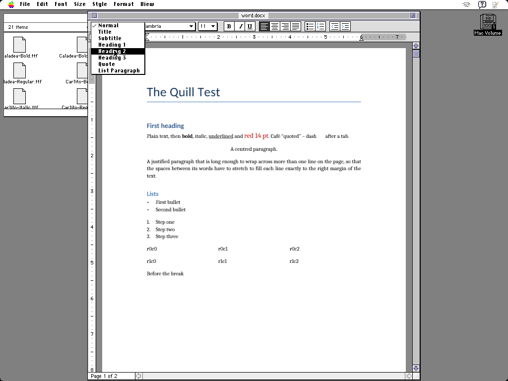
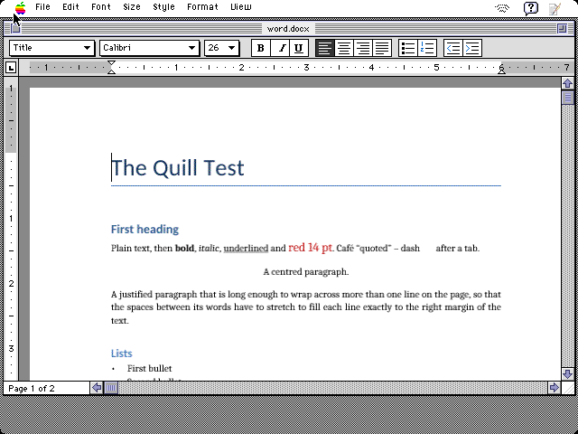
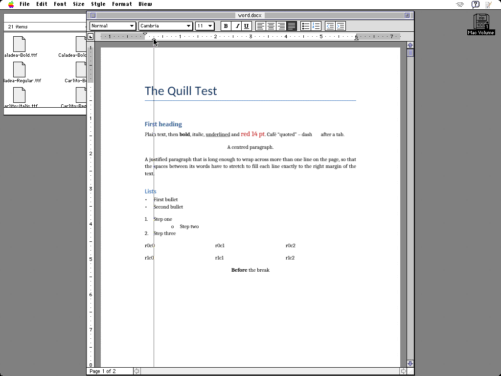
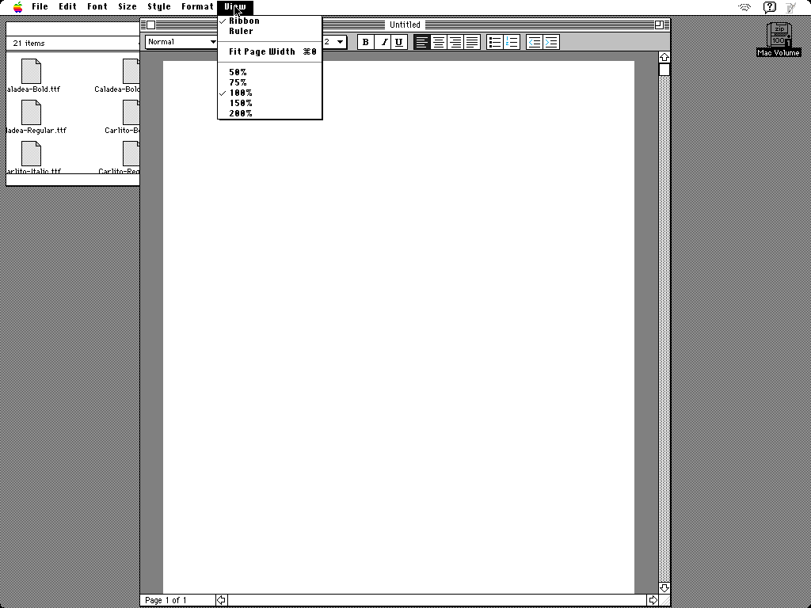
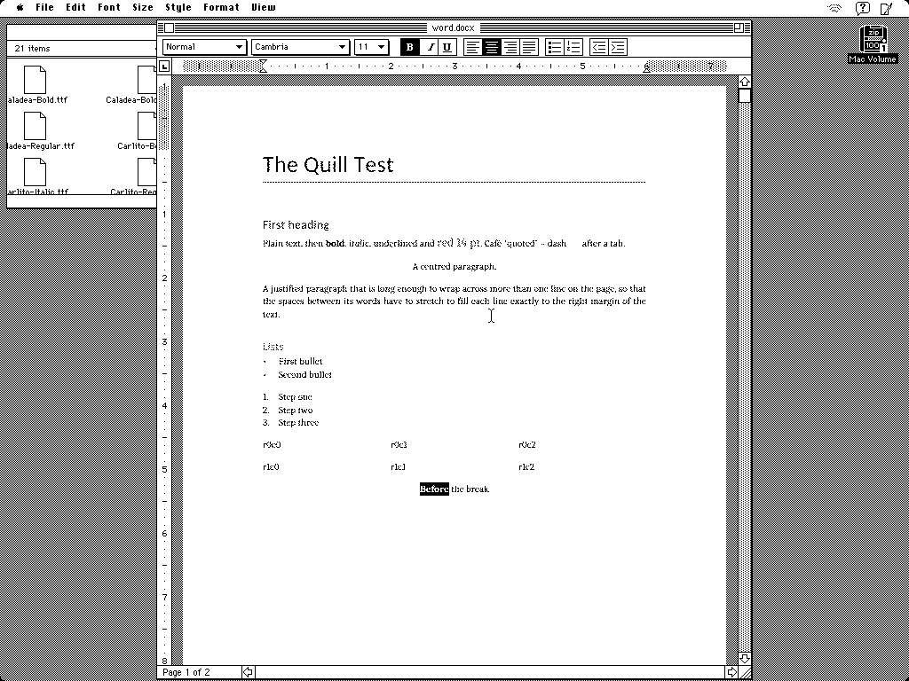

# Quill for the classic Mac OS

Quill runs on a Macintosh with a 68030 or 68040 and System 7: it opens a Word document, shows its pages
as Quill draws them for PDF, lets you type and format, and saves .docx again. This is the story of the
port, how to build and install it, what it does and what it does not do yet. Started 18 November 2026 on
branch `mac-port`.

## How it is made

Quill's core (`core/`) is portable C99 and is used unchanged. The Amiga front end (`amiga/`, about
50,000 lines) is not: it draws text itself with Amiga bitmap fonts made from Quill's TrueType fonts,
through graphics.library, layers and diskfont, and its ribbon, panes and dialogs are hundreds of MUI
objects of kinds the Mac's MUI does not have. So the Mac got a front end of its own, small and in MUI
too (`mac/`), which runs on Riptide's MUI for the Mac (riptide `src/mac/mui`, docs/MAC-GUI.md there):
Application and Window objects, a NewMenu strip, MUI_RequestA and the ASL requester become the Mac's
own window, menu bar, alerts and Standard File, laid out as Apple's Human Interface Guidelines (1992)
ask. The same Riptide tree builds RiptidePrefs and Lagoon for the Mac.

| File | What |
|---|---|
| `mac/qm_main.c` | the application: the window, the menus and their check marks, files, the Edit menu, the commands |
| `mac/qm_view.c` | the page view, a MUI Area subclass: drawing, scrolling, the caret and selection, keys and clicks; the strip and rulers inside its box |
| `mac/qm_strip.c` | the tool strip (View › Ribbon): pop-up menus and icon buttons, each a menu command |
| `mac/qm_ruler.c`, `core/ruler.c` | the rulers (View › Ruler): drawing and dragging on the Mac; the sums, shared and tested natively |
| `mac/qm_lang.c` | `tr()`: Quill's interface words (`amiga/lang_table.h`) in Mac Roman, the language from the System's region |
| `mac/qm_text.c` | Mac Roman to and from UTF-8 and Latin-1 |
| `mac/libc.c`, `mac/include/` | the C library the core needs (allocator, stdio over the File Manager, time, strings, sorting) |
| `mac/softfp.c` | integer and float conversions without an FPU, in place of libgcc's 68881 ones ("Floating point" below) |
| `mac/qm_mac.c` | the File Manager by path, file types and creator, FlushVol, the clock, the log, the System's region |
| `mac/qm_thunks.S` | the class dispatcher's register entry and 32-bit QuickDraw's offscreen calls |
| `mac/traps.txt` | the Toolbox calls Quill adds to Riptide's list (CopyBits, Draw1Control, EventAvail, resources) |
| `mac/mkfinder.py`, `mac/rsrc/` | the Finder's resources: bundle, file references, icons in every size and depth, 'vers' |

### Pages on the screen, 1 to 32 bits

The view never draws text through the Toolbox. For each page it shows it asks the core for the page as
pixels (`pdf_page_rgb`, core/raster.c: exactly what Export PDF writes, drawn with Quill's own TrueType
rasteriser in fixed point), at the zoom's resolution: 72 dots per inch at 100%, the Mac screen's own, so
a 12-point letter is 12 pixels high. It keeps the last three pages drawn. Everything that reaches the
window goes through one routine, `blit()`: a rectangle of one page converted a band of 32 rows at a time
into an offscreen 32-bit GWorld, with the selection and the caret mixed in, and copied with CopyBits.
CopyBits fits the colours to the screen, whatever its depth: on 1-bit and indexed screens with
`ditherCopy`, on 16 and 32 bits as they are. On a 1-bit screen each level is stretched first (72 and
darker black, 200 and lighter white), because smoothed text edges dithered as they are come out speckled;
pictures keep their dithered shades.

charts.docx was also opened at 1, 2, 4, 8, 16 and 32 bits (18 November 2026, PiDepth setting the depth):
the charts are drawn at every depth, dithered below 16 bits. The page box beside the horizontal scroll bar
shows the page at the top of the window, as Word for the Mac did, and the number of pages.

Only what changed is copied. An update event (a window uncovered) redraws the visible region's box; the
caret blinks by copying its one-pixel column again; a selection that grows redraws the rows between the
old and new end. After an edit the page is drawn again in memory, compared row by row with the picture it
replaces, and only the rows that differ are copied. Typing does not draw a page per key: the keys change
the document at once, and the page is drawn again when no more keys are waiting (`EventAvail`), or after
a second at the latest. Scrolling moves what is still visible with ScrollRect and draws only the strip
that came into view. The watch shows while a page is drawn.

| Screen | Screenshot (testbed, System 7.1, 1024 by 768) |
|---|---|
| 1 bit | [mac-1bit.png](mac-1bit.png): the document after typing, Bold, Save, Close and Open; the Style menu down |
| 8 bits | [mac-8bit.png](mac-8bit.png): tests/data/word.docx just opened |
| 32 bits | [mac-32bit.png](mac-32bit.png): text typed at the start, five letters selected and made bold |
| 8 bits | [mac-charts-8bit.png](mac-charts-8bit.png): tests/data/charts.docx just opened, "Page 1 of 3"; [mac-charts-8bit-page2.png](mac-charts-8bit-page2.png): scrolled to page 2 |

### Floating point: soft-float

The Mac build is compiled `-msoft-float` with libgcc's routines, not `-m68881`. Reasons:

- It runs on every 68030 and 68040 Mac. The LC II, LC III, Classic II, Color Classic and Performa 400
  have no FPU, the LC 475/Quadra 605 and the Performa 47x have a 68LC040, and a `-m68881` program dies
  with an F-line exception on all of them (Apple shipped no FPU emulation).
- Nothing that runs while typing uses it. The layout (`core/layout.c`: no `double` at all), the
  TrueType rasteriser and the page drawing (`core/raster.c`) are integer arithmetic, fixed point. In
  `core/` doubles appear in charts (`chart.c`), a few file readers and writers (`docx.c`, `odt.c`, `rtf.c`,
  `html.c`) and SmartArt, used briefly when such a document is read or a chart drawn.
- Not measured on hardware: what an FPU would gain for charts. A `-m68881` build is one flag away
  (`BASE` in Makefile.mac) for a Mac known to have one.

libgcc's soft-float code (built position-independent for Linux) reaches its rounding-mode variable through
a global offset table; Riptide's `tools/mac_elf.py` now relocates that table's entries.

**libgcc's conversions are FPU code (found 18 November 2026).** Debian's and Ubuntu's `m68k-linux-gnu`
compiler has one libgcc, built for a 68020 with a 68881 (`-print-multi-lib` shows only `.`). Its double
arithmetic and comparisons (`_double.o`, from `lb1sf68.S`) are integer code that take and give doubles in
D0/D1, as `-msoft-float` code expects. Its conversions are not: `fpgnulib.o` (`__floatsidf`, `__fixdfsi`,
`__extendsfdf2`, `__truncdfsf2` and six more) is C compiled for the 68881. It uses FMOVE and returns in FP0. So
every `(double)i` in the core gave whatever D0/D1 held. Charts showed it first: a chart's 4.3 was read as
2.7e+153 and every chart was drawn as an empty box. With an FPU (the testbed's 68040) the result was wrong. On
a Mac without one, the FMOVE would have stopped Quill with an F-line exception. `mac/softfp.c` now defines all
ten functions in integer arithmetic, rounding to nearest, ties to even. Makefile.mac fails the build if the map
shows `fpgnulib.o` linked again. Tested:
- natively, against a PC's FPU, 20 million random and edge values, all identical (the file compiles for either
  byte order);
- the core built `-m68020 -msoft-float` with it, run under qemu-m68k: charts.docx's first page is identical,
  pixel for pixel, to the native build.

The earlier check with word.docx had passed only because nothing on that page converts an integer to a double.

### Speed

Drawing one US Letter page at 72 dpi in the testbed (QEMU emulating the Pi 3 that runs Emu68, many times
slower than real hardware): an empty page 82 ticks (1.4 s), tests/data/word.docx's first page 200 to 290
ticks (3.3 to 4.8 s). On the host the same page takes 2 ms. The log (`make -f Makefile.mac AURORA68=1`)
prints each page's time. A 25 MHz 68030 should be around a second a page; that is why typing is drawn
once the keys stop rather than per key, and why only changed rows are copied.

## The tool strip and the rulers

The Amiga's Quill has WordCraft's ribbon. System 7 has no ribbon, and Cornerstone's classic Mac chapter
(the family's style guide, `docs/platforms/classic-mac/README.md` in Cornerstone) says what becomes of it:
the ribbon's most used tools go into one row in the document window under the title bar, its drop-down
lists become pop-up menus, and everything stays in the menus. Word for the Mac had such a row and called
it the Ribbon, so the View menu does too.

**The strip** (`mac/qm_strip.c`) holds what the Amiga's Home tab is used for most: the paragraph style,
font and size as pop-up menus; Bold, Italic and Underline; the four alignments; bulleted and numbered
lists; Decrease and Increase Indent. Each item is a menu command (Format › Paragraph Style, Font, Size,
Style, Format) with the same number; a click runs that command, and the item draws itself from
`qm_state()`, the one answer the menus' check marks and dimming are set from, so a button and its menu
item never disagree. A pop-up shows its menu's items with the current one checked; its box shows the
caret's value even when the menu has no such item (Calibri, 11 points). The icons are the Amiga's
(`amiga/theme.c`, Cornerstone's icon language), drawn with QuickDraw in Geneva 9's strip: black and white
first (a button that is on is inverted, one held down inverts while the pointer is on it), coloured from
four bits up, with B, I and U in bold Times as Word's were. The whole strip is about 540 pixels wide, so
it fits a 640-pixel window; a narrower window drops whole groups from the right (indents, then lists,
alignment, character styles), whose commands stay in the menus. Show ¶ is left out: the page view draws
pages as their PDF looks (`pdf_page_rgb`), which has no paragraph marks to show.

**The rulers** (`mac/qm_ruler.c`, with the sums in `core/ruler.c`, shared and tested natively in
`tests/test_wpmac.c`): the horizontal ruler under the strip lines up with the page as it scrolls and
zooms, in inches on a US Letter page and centimetres on any other (as the Amiga decides), the margins
shaded and the text area white, numbered from the text's edge. The first-line indent hangs from the top,
the left and right indents stand on the bottom, and the caret paragraph's tab stops show; in a table the
column edges show as blocks. Dragging a marker is tracked as the Mac tracks a control: the ruler follows
and a dotted line over the pages shows where it will be; the change is made when the button goes up, as
one undoable edit (the indents or tab stops of the selected paragraphs, or the table's column widths:
the Amiga's CMD_INDENTS, CMD_TABS and CMD_COLEDGE). A click on the lower half makes a tab stop of the
kind the box at the corner shows (click the box for left, centre, right, decimal); a stop dragged off the
ruler goes. The vertical ruler on the left shows the page's top and bottom margins, as on the Amiga
(there, too, it does not drag).

| | |
|---|---|
|  |  |
|  |  |
|  |  |
|  |  |

View › Ribbon and View › Ruler are checkmarked items (Guidelines p. 75), kept in **Quill Preferences**
(type `pref`) in the Preferences folder. The pages' area, the scroll bars, updates and the caret all keep
to what is left: the vertical scroll bar starts under the ruler.

## Building

    make -f Makefile.mac                     build/mac/Quill.bin (MacBinary)
    make -f Makefile.mac AURORA68=1 B=build/mac-a68    the log also goes to Aurora68's kernel log

Needs the m68k ELF toolchain (`gcc-m68k-linux-gnu`, `binutils-m68k-linux-gnu`), Python 3 and Riptide's
tree beside Quill's (`RIPTIDE ?= ../riptide`, branch `mac-port`). The icons are made by `mac/mkfinder.py`
(needs PIL) and kept in `mac/rsrc/`, so the build itself does not need PIL.

## Installing

Copy `build/mac/Quill.bin` to the Mac (`hcopy -m` onto an HFS image, or any MacBinary decoder), and beside
it a folder named **Fonts** holding everything in `fonts/` (the `.ttf` files and `fonts.list`). Quill
looks for `:Fonts:` in its own folder at launch. Its memory size is 12 MB: a page drawn at 100% is
1.4 MB of pixels and three are kept, a .docx is unzipped in memory and a font in use is loaded whole.

Documents: Quill opens anything its core reads (.docx, .doc, .odt, .rtf, .html, .md, .txt), whatever its
Mac type, since Word documents from other computers arrive typed `????`. It saves by the name's ending, a
.docx when the name has none, and gives the file the Mac type for its format and Quill's creator
`QUIL`: `TEXT` for text formats, `DOCX` for .docx/.docm/.dotx, `ODT ` for .odt, `PDF ` (Acrobat's
creator) for exported PDFs. Its bundle tells the Finder that Quill opens `DOCX` and `TEXT` files and gives
them Quill's document icons; documents double-clicked or dropped on Quill in the Finder are opened (the
first one: one window, one document).

## Using it

The window is a document window with the page number box ("Page 1 of 2") beside the horizontal scroll
bar, as Word 5 for the Mac had it. Click to place the insertion point, drag or Shift-click to select,
double-click a word. Arrow keys move, Option-Left/Right by words, Option-Up/Down to the line's ends, Shift
extends the selection; Home and End go to the document's ends, Page Up and Page Down scroll; Delete and
forward delete, Option with them a word; Return a new paragraph, Shift-Return a line break.

| Menu | Commands (Command keys) |
|---|---|
| Apple | About Quill… |
| File | New ⌘N, Open… ⌘O, Close ⌘W, Save ⌘S, Save As…, Revert, Export PDF… ⌘D, Quit ⌘Q |
| Edit | Undo ⌘Z, Cut ⌘X, Copy ⌘C, Paste ⌘V, Clear, Redo ⌘Y, Select All ⌘A |
| Font | Quill's families (Caladea, Carlito, Liberation Mono, Sans and Serif), the caret's checked |
| Size | 9 10 12 14 18 24 36, Grow Font ⌘>, Shrink Font ⌘< |
| Style | Plain Text ⌘T, Bold ⌘B, Italic ⌘I, Underline ⌘U, Strikethrough, Superscript ⌘+, Subscript ⌘- |
| Format | Paragraph Style ▸ (Normal, Title, Subtitle, Heading 1-3, Quote, List Paragraph), Align Left ⌘[, Centre ⌘E, Align Right ⌘], Justify ⌘J, Bullets, Numbering, Decrease Indent ⌘K, Increase Indent ⌘M, Single ⌘1, 1.5 Lines ⌘5, Double ⌘2, Page Break |
| View | Ribbon, Ruler, Fit Page Width ⌘0, 50%, 75%, 100%, 150%, 200% |

The keys are the Amiga's where the Mac does not reserve them (Guidelines p. 128). Changed: Save As has no
key (the Amiga's Amiga-A is Select All on the Mac, whose Amiga-L is gone), Page Break has none (Amiga-P is
Print), Table (Amiga-T) is not on the Mac, whose ⌘T is Plain Text as the Guidelines' Style menu has it.
A Style, Font or Size command applies to the selection, or to the word the caret is in, as Word does;
between words it sets what is typed next. Cut and Copy put the text on the Clipboard for other programs
(Mac Roman, returns between paragraphs) and keep Quill's own copy with its formatting for Paste in Quill.
Closing the window asks to save changes (Save, Don't Save, Cancel) and leaves Quill running; New and Open
bring the window back. The interface is in English, German, French, Spanish or Italian, from the System's
region ('vers' 1), with the words Quill's Amiga version uses.

## Quill and the Guidelines: Cornerstone's classic Mac chapter, point by point

Checked on 18 November 2026 against Cornerstone's classic Mac chapter and Apple's *Macintosh Human
Interface Guidelines* (1992), whose page numbers these are. **Conforms**, **changed** (in this branch),
or **left** (and why).

| Point | Quill on the Mac |
|---|---|
| Menus and their order (pp. 49-130) | **Conforms.** Apple, File, Edit, then Quill's Font, Size, Style, Format and View, then the system's Help and Application menus. Five menus of Quill's own, Cornerstone's limit for a small screen (p. 80). |
| Apple menu (p. 98) | **Conforms.** About Quill… first, a line, the desk accessories (Riptide's Mac MUI). |
| File (pp. 99-109) | **Changed:** Revert added, dimmed until a document read from a file is changed; it asks first, Cancel the default (it loses changes). Page Setup and Print are left out rather than shown dimmed for ever, as Cornerstone asks: Quill does not print yet. Export PDF… sits after Save As. |
| Edit (pp. 109-117) | **Conforms**, with one difference left: Undo, Cut, Copy, Paste, Clear, then Quill's Redo and Select All after a line, where Riptide's layer puts a program's own Edit items. Show Clipboard is not offered. |
| Preferences | **Conforms by having none to set in a dialog:** the only settings (Ribbon, Ruler) are View's toggles, remembered between sessions (p. 37). A Preferences… item comes with a first dialog of settings. |
| Item names (pp. 58, 67) | **Conforms.** Title case, "…" where a dialog follows (Riptide turns "..." into the ellipsis character). |
| Hierarchical menus (p. 79) | **Changed:** Format › Paragraph Style is a submenu of the styles every Quill document has (Riptide's layer gained submenus for it). |
| Command keys (p. 128) | **Conforms.** N O W S Q Z X C V A keep Apple's meaning; P and period are unused (no printing, no long operation to stop yet). T B I U are the Style menu's. The Amiga's other keys stay where the Mac leaves them free: D Export PDF, Y Redo, E [ ] J alignment, 1 5 2 spacing, < > font size, + - super- and subscript, 0 Fit Page Width, and now K and M for the indents. F and G are not used: there is no Find yet. |
| Dimming (pp. 54, 60, 63) | **Conforms.** Undo, Cut, Copy, Clear and Paste follow what can be done (`mm_edit_state`); a paragraph style the document lacks is dimmed, not removed; Revert is dimmed until there is something to revert. Every item's dimming comes from `qm_state()`. |
| Toggles (p. 75) | **Conforms.** Style, alignment, spacing, lists, zoom, Ribbon and Ruler show check marks, from the same answer as the strip's buttons. |
| No ribbon; a tool strip; pop-up menus (pp. 82-91, 96-97) | **Changed:** the strip and rulers above. The strip is inside the document window under the title bar, nowhere near the scroll bars or the close box; its lists are pop-up menus with a shadowed box and a triangle; it invents no command. |
| Windows (pp. 131-174) | **Conforms** for the window: title bar, close box, zoom box, size box, scroll bars inactive when the page fits, staggered placement (Riptide). **Left:** one window, one document (opening another asks to save the first). |
| Status box (p. 161) | **Conforms.** "Page 1 of 2" at the left end of the horizontal scroll bar, as Word 5 had it, following the page at the top of the window. |
| Dialogs and button order (pp. 185, 196, 204-206) | **Conforms** through Riptide's alerts: the action at the bottom right, Cancel to its left, the default ringed and answering Return and Enter, Cancel answering Esc and Command-period. Open, Save As and Export PDF are Standard File. Quill has no dialogs of its own yet (Find, Page Setup). |
| Alerts (pp. 193-196) | **Partly left.** Riptide chooses the icon by the number of buttons: a note for one, a caution for more. So "couldn't be read" shows a note where a stop belongs. `MUI_RequestA` has no level to pass; giving Riptide's requester one is the fix. |
| Progress (pp. 185, 206) | **Left.** Opening a long document shows the watch, not a movable modal dialog with a Stop button; nothing in Quill can be stopped part way yet. |
| Fonts (pp. 23, 60, 207) | **Changed:** the strip and rulers use Geneva 9, as Cornerstone asks for palettes. Menus and alerts are the system font; the page box uses Riptide's Geneva 9 or 10 (10 on screens taller than 600 lines). **Left:** the Font menu does not show families in their own faces: they are Quill's TrueType fonts, which the Font Manager does not have. |
| Colour and one bit (pp. 258, 263-264) | **Conforms.** Everything was laid out on one bit first: the strip is white with black frames and inverted "on" buttons, the ruler's margins a light pattern. Colour from four bits up is only the icons' accents and light greys; the selection takes the Color control panel's highlight colour. |
| Balloon Help (pp. 316-325) | **Left.** No `hmnu` or `hrct` balloons yet. Quill's help texts are written for the Amiga's ribbon bubbles (`amiga/ribbon.c`), and Riptide's layer shows its own bubbles only for MUI objects with `MUIA_ShortHelp`, which the strip, drawn by the view, is not. Generating `hmnu` resources from the strings table is the way. |
| Keyboard (pp. 277, 282-283) | **Conforms** for moving and selecting: arrows, Option-arrows by words, Shift extending, Home, End, Page Up and Page Down. **Left:** Option-Up and Option-Down go to the line's ends, the Amiga's habit, where many Mac programs used Command-Left and Command-Right; the Guidelines leave Command-arrows to keyboard scripts. |
| Strings and localisation (pp. 15-24) | **Conforms:** every word through `tr()` from `tools/lang/`, five languages, the System's region choosing, Mac Roman throughout. **Changed:** the Style menu was "Formatvorlage" (a paragraph style) in German; it is now "Stil", as the Mac's German system calls it (`menu:Style` in `tools/lang/mac.py`). |

## Tested

In the Aurora68 testbed (QEMU, the solo board, a copy of the System 7.1 image with Quill and its fonts in
Startup Items and `PiDepth N` setting the screen to N bits; `mac.screen=1024x768` with its declaration
ROM), at 1, 8 and 32 bits, scripted through QEMU's monitor (keys and mouse):

1. Quill starts with an empty Untitled document.
2. ⌘O, Standard File, ⌘↑ twice to the disk, "word" selects word.docx (a copy of tests/data/word.docx),
   Return: the document opens, the window is titled word.docx, "Page 1 of 2".
3. "Hello from the Mac. " typed at the start of the heading; Shift-Right five times selects "The Q"; ⌘B.
4. ⌘S saves (no dialog: the document has a name); ⌘W closes the window without asking (nothing unsaved);
   ⌘O and word.docx again: the text and the bold are there.
5. The saved file, copied off the disk image, read by the core on the host: `Hello from the Mac. ` and a
   bold run `The Q` in word/document.xml, the rest of the document as before.

Also: Quill's core with `mac/libc.c` in place of the system's C library, built for the host and for the
68020 with `-msoft-float` and run under qemu-m68k, draws word.docx's first page identical, pixel for
pixel, to the native build. The native tests (2556) pass; `tools/langcheck.py` finds nothing missing.

### The strip and the rulers (18 November 2026)

In the same testbed, at 1, 4, 8 and 32 bits on a 1024 by 768 screen and at 8 bits on a 640 by 480 one
(the default declaration ROM is that size), with tests/data/word.docx, the mouse driven through QEMU's
monitor:

1. Opened, the strip shows the caret's style, font and size (Title, Calibri, 26) and the ruler the page:
   inches on this US Letter page, the indents on the text's edges.
2. "Before" double-clicked, then the strip's Bold and Centre: the word bold, the paragraph centred, both
   buttons on, the menus' check marks the same.
3. "Step two": Bullets, then Increase Indent: a bullet, one level in; Bullets shown on.
4. The font pop-up held open (the Font menu's families), Liberation Serif chosen for "heading"; another
   run, Liberation Sans for "Plain": the box and the text follow (but see below).
5. The justified paragraph's left indent dragged half an inch (the dotted line follows): a hanging
   indent. A tab stop clicked at 4 inches on "Plain text…", then dragged to 5½: "after a tab" moves there.
   In a table, the middle column edge dragged half an inch: the columns follow.
6. ⌘S, then the disk image read on the host: in word/document.xml the justified paragraph has
   `<w:ind w:left="720" w:hanging="720"/>`, "Plain text…" `<w:tab w:val="left" w:pos="7920"/>`, "Before
   the break" `<w:jc w:val="center"/>` with "Before" `<w:b/>`, "Step two" `<w:ilvl w:val="1"/>`, and the run
   "heading" `<w:rFonts w:ascii="Liberation Serif" …/>`.
7. Format › Paragraph Style (a submenu) chose Heading 2; View › Ruler and View › Ribbon hid them, and
   "Quill Preferences" (type `pref`) held `ribbon 0`, `ruler 0`; a disk with `ruler 0` in it started
   without the ruler and with View › Ruler unchecked.
8. File › Revert after typing: the caution alert, Cancel the default; Revert reads the file again.
9. On the 640 by 480 screen the window is 632 wide and the whole strip fits; narrowed to about 390
   pixels with the size box, the alignment, list and indent groups go and the pop-ups and B I U stay.

The native tests (2600, 44 of them the ruler's in tests/test_wpmac.c) pass, both Mac builds have no
warnings, and `tools/langcheck.py` finds nothing missing for `amiga/` or `mac/`.

## Not done yet

- **Printing** is left out. Quill draws pages for PDF; Export PDF writes one. Printing needs the Printing
  Manager's QuickDraw (PrOpen, PrOpenDoc, a page at the printer's resolution through the same CopyBits
  path), not hard, not done.
- **One window, one document.** The Amiga has several windows; the Mac version opens one document at a
  time (opening another asks to save the first).
- **Only the commands in the menus above** (and the strip's, which are the same). No panes or dialogs:
  no Find and Replace, styles gallery, tables to insert, pictures, comments, track changes, spelling, page
  setup or headers and footers to edit, though the core keeps all of them in a document it reads and
  writes them out again.
- **The strip and rulers**: no Balloon Help for them; the vertical ruler does not drag the margins (nor
  does the Amiga's); no Show ¶ (the page view has no marks to show); the units follow the page size, as
  there is no unit preference yet. The Amiga's ruler (amiga/ruler.c) still does its own sums: switching it
  to core/ruler.c needs the vbcc build to check, which this machine lacks.
- **A font chosen but not seen**: in the testbed, Liberation Serif chosen for the bold heading's word was
  in the document (the saved file says so, and the host draws it serif), but the Mac's page kept drawing
  the sans face; Liberation Sans on body text showed at once. Not explained yet; a font that fails to load
  on the Mac (memory, with three pages kept) falls back silently, so that is the first suspect.
- **Selection** is drawn line by line from margin to margin between its ends (not hugging each line's
  text), and the caret's line is found by the core's layout, so tables and columns select roughly.
- **Speed** on a real 68030 is unmeasured; the testbed's figures are above. Drawing only a band of the
  page (the core draws whole pages) would make typing on slow machines cheaper.
- **Apple events**: Quill takes documents from the Finder by the Segment Loader's parameters (System 6
  style, which the System 7 Finder still sends to programs that do not declare high-level events); 'odoc'
  while running, and drag-and-drop onto a running Quill, are not handled.
- The Font menu draws family names in the system font, not in themselves; the Style menu does not show
  its items in their styles.
